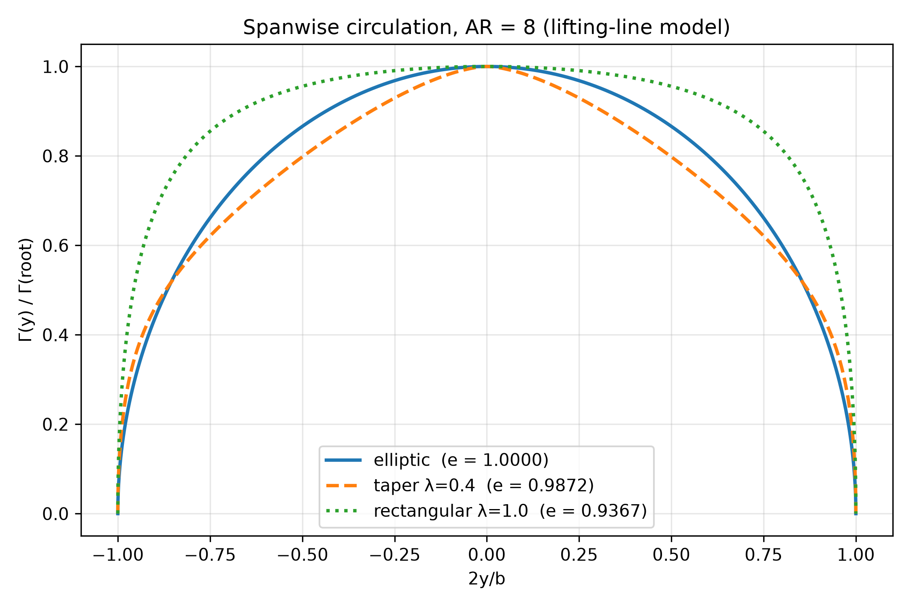
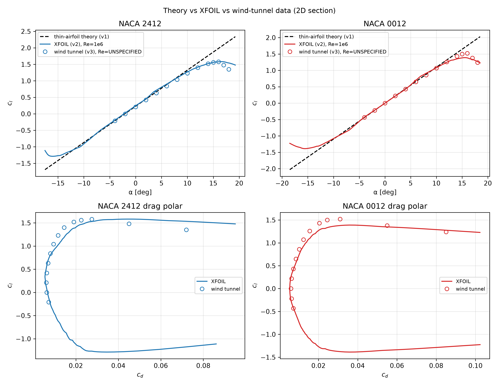

## 1. Problem
How does camber change the lift and drag-polar behavior of an airfoil? We compare a cambered airfoil (**NACA 2412**) with a symmetric one (**NACA 0012**) of equal thickness ($`12\%`$).

---

## 2. Geometry (`geometry.py`)
For a NACA 4-digit code $`MPTT`$: $`m = M/100`$ (maximum camber), $`p = P/10`$ (chordwise position of maximum camber), $`t = TT/100`$ (maximum thickness), with unit chord $`c = 1`$.

**Thickness distribution (empirical NACA fit with closed trailing edge):**

```math
y_t = 5t\left(0.2969\sqrt{x} - 0.1260x - 0.3516x^2 + 0.2843x^3 - 0.1036x^4\right)
```

**Camber line (two parabolic arcs joined at $`x = p`$):**

```math
y_c = \begin{cases} \dfrac{m}{p^2}(2px - x^2), & x < p \\[8pt] \dfrac{m}{(1-p)^2}\left((1-2p) + 2px - x^2\right), & x \ge p \end{cases}
```

**Upper and lower surfaces** (offset perpendicular to the camber line with $`\theta = \arctan(dy_c/dx)`$):

```math
x_u = x - y_t \sin\theta, \qquad y_u = y_c + y_t \cos\theta
```

```math
x_l = x + y_t \sin\theta, \qquad y_l = y_c - y_t \cos\theta
```

**Verification (`check_geometry`).** NACA 2412 gives a maximum camber of $`0.0200`$ at $`x = 0.400`$ and maximum thickness $`2y_t = 0.1200`$ at $`x = 0.300`$, with a closed trailing edge ($`y_t(1) = 0`$). These match the NACA 4-digit definition.

---

## 3. Lift (`aerodynamics.py`)
**Physical principle.** In thin airfoil theory, the airfoil is replaced by a vortex sheet placed along the camber line. The flow-tangency condition fixes the vortex strength distribution, and the Kutta condition fixes the total circulation.

**Assumptions.** 2D, inviscid, incompressible, small angles of attack, thin airfoil.

**Result.** With the coordinate transformation $`x = \frac{1 - \cos\theta}{2}`$, the tangency condition becomes a Fourier cosine series problem whose first two coefficients yield:

```math
c_l = 2\pi(\alpha - \alpha_{L0})
```

```math
\alpha_{L0} = -\frac{1}{\pi}\int_0^\pi \frac{dy_c}{dx}(\cos\theta - 1)\,d\theta
```

**Interpretation.** The 2D lift-curve slope $`a_0 = 2\pi\text{ rad}^{-1}`$ does not depend on camber; camber only shifts the zero-lift angle $`\alpha_{L0}`$. For a symmetric airfoil, $`dy_c/dx = 0`$, so $`\alpha_{L0} = 0`$.

**Finite wing (Prandtl lifting line).**

```math
a = \frac{a_0}{1 + \dfrac{a_0}{\pi e \, \text{AR}}}, \qquad a_0 = 2\pi
```

For $`\text{AR} = 8`$ and $`e = 0.85`$, this gives $`a = 4.855\text{ rad}^{-1}`$ (where $`\text{AR}`$ and $`e`$ are assumed inputs in v1).

**Numerical result.**
* **NACA 2412:** $`\alpha_{L0} = -2.077^\circ`$, giving a finite-wing lift coefficient $`C_L(\alpha = 0^\circ) = 0.176`$ (standard tabulated experimental values for NACA 2412 are approximately $`-2.0^\circ`$).
* **NACA 0012:** $`\alpha_{L0} = 0^\circ`$, giving $`C_L(\alpha = 0^\circ) = 0`$.

---

## 4. Drag
**Assumed model.**

```math
C_D = C_{D0} + \frac{C_L^2}{\pi e \, \text{AR}}
```

* The second term is induced drag, which exists only for a 3D finite wing and not for a 2D airfoil.
* $`C_{D0} = 0.010`$ is an assumed zero-lift drag placeholder for both airfoils; it is neither computed by the inviscid model nor measured.

---

## 5. Efficiency
Setting $`\dfrac{d(C_L/C_D)}{dC_L} = 0`$ gives the optimal lift coefficient and maximum lift-to-drag ratio:

```math
C_L^* = \sqrt{C_{D0}\,\pi e \, \text{AR}}, \qquad \left(\frac{L}{D}\right)_{\max} = \frac{1}{2\sqrt{C_{D0}\,k}}, \qquad k = \frac{1}{\pi e \, \text{AR}}
```

**Numerical check.** Both airfoils yield $`C_L^* = 0.462`$ and $`(L/D)_{\max} = 23.11`$. The numerical simulation and closed-form solution agree.

| Airfoil | $`\alpha_{L0}`$ | $`C_L(0^\circ)`$ | $`(L/D)_{\max}`$ | $`\alpha`$ at $`(L/D)_{\max}`$ |
| :--- | :---: | :---: | :---: | :---: |
| NACA 2412 | $`-2.08^\circ`$ | $`0.176`$ | $`23.11`$ | $`3.4^\circ`$ |
| NACA 0012 | $`0^\circ`$ | $`0`$ | $`23.11`$ | $`5.5^\circ`$ |

---

## 6. Findings
1. **Supported by the model:** A cambered airfoil produces positive lift at $`\alpha = 0^\circ`$. Its lift curve is shifted leftward by $`|\alpha_{L0}| \approx 2.1^\circ`$ relative to the symmetric airfoil.
2. **Supported by the model:** The best-glide point occurs at the same $`C_L^*`$ ($`0.462`$) for both airfoils, but at a smaller angle of attack for the cambered airfoil ($`3.4^\circ`$ vs. $`5.5^\circ`$).
3. **Not supported by this model:** That NACA 2412 has a higher peak $`L/D`$. In a parabolic drag polar with equal $`C_{D0}`$, $`(L/D)_{\max}`$ is independent of camber. Any real difference comes from airfoil-specific $`C_{D0}`$, which depends on Reynolds number and surface condition.
4. **Not modeled:** Stall. The linear lift curve has no maximum, so the drag rise and efficiency loss at high angles of attack seen in real wings do not appear here.

---

## 7. Limitations
* Linear regime only ($`\alpha \approx -4^\circ`$ to $`12^\circ`$).
* Airfoil thickness does not affect $`C_L`$ in thin airfoil theory.
* No viscosity, Reynolds number, Mach number, or ground effects.
* $`C_{D0}`$, $`\text{AR}`$, and $`e`$ are assumed constants in v1.

---

## 8. Next Steps
* Obtain viscous polars for both airfoils (from XFOIL or a wind-tunnel dataset with a cited Reynolds number) and replace the assumed $`C_{D0}`$ with airfoil-specific values.
* Compare the thin-airfoil $`C_L(\alpha)`$ against viscous and experimental data and quantify the deviation.
* Restrict inviscid conclusions to the pre-stall linear range.

---

## 9. Viscous Benchmark Comparison (`validate_viscous.py`)

**What is compared.** The v1 thin-airfoil model is compared against XFOIL viscous polars from Airfoil Tools at $`Re = 1.0 \times 10^6`$ and $`N_{\text{crit}} = 9`$. Because XFOIL is itself a viscous panel/boundary-layer model, this represents a model-to-model comparison rather than experimental validation.

**2D to 3D mapping.** Each 2D XFOIL polar point $`(\alpha_{2\text{D}}, c_l, c_d)`$ is mapped to a finite wing of aspect ratio $`\text{AR} = 8`$ and span efficiency $`e = 0.85`$ using:

```math
\alpha_{3\text{D}} = \alpha_{2\text{D}} + \frac{c_l}{\pi e \, \text{AR}}, \qquad C_L = c_l, \qquad C_D = c_d + \frac{c_l^2}{\pi e \, \text{AR}}
```

This mapping assumes elliptic spanwise loading and neglects 3D viscous effects, sweep, and taper.

**Results (`section8_table.md`).**

*(Paste the table lines from your local `section8_table.md` file right here)*


**Interpretation.** Thin-airfoil theory assumes attached, inviscid flow, so close agreement with XFOIL is expected only at small and moderate angles of attack. At higher angles, the adverse pressure gradient on the suction surface thickens the boundary layer and triggers flow separation, which caps $`c_l`$ and sharply increases $`c_d`$; neither effect exists in the inviscid model. Differences in $`(L/D)_{\max}`$ between NACA 2412 and NACA 0012 are governed by differences in viscous minimum drag $`c_{d,\min}`$ and are resolved to within the angle-of-attack step size of the XFOIL polar (noting that XFOIL points near stall may exhibit incomplete boundary-layer convergence).

## 10. Numerical Lifting-Line, Experimental Comparison and C++ Benchmark

### 10.1 Numerical lifting-line solver (`lifting_line.py`)

**Principle.** Prandtl lifting-line theory represents the wing by a bound vortex whose circulation varies along the span. Assumptions: incompressible, inviscid, small angles, unswept untwisted wing, section lift slope $`a_0 = 2\pi`$, symmetric loading.

**Equation.** With $`\Gamma = 2 b V \sum A_n \sin(n\theta)`$, $`y = -(b/2)\cos\theta`$, and the local effective angle $`\alpha_{\text{eff}} = \alpha - \alpha_{L0} - \alpha_i`$, where $`\alpha_i = \sum n A_n \sin(n\theta)/\sin\theta`$, the section relation $`\Gamma = \frac{1}{2} V c a_0 \alpha_{\text{eff}}`$ gives the monoplane equation at $`N`$ stations $`\theta_i = \frac{i\pi}{2N}`$:

```math
\sum_{\text{odd } n} A_n \sin(n\theta_i) \left[ \frac{4b}{a_0 c(\theta_i)} + \frac{n}{\sin\theta_i} \right] = \alpha - \alpha_{L0}
```

The solution gives $`C_L = \pi \, \text{AR} \, A_1`$, $`\delta = \sum_{n \ge 3} n (A_n/A_1)^2`$, $`e = \frac{1}{1 + \delta}`$, and $`C_{Di} = \frac{C_L^2}{\pi e \, \text{AR}}`$.

**Verification (computed).** An elliptic planform returns $`e = 1.000000000000`$ and $`C_L`$ equal to the analytic value $`a\alpha`$ with $`a = \frac{a_0}{1 + a_0/(\pi \, \text{AR})}`$. For $`N = 10, 20, 40, 80, 160`$, the rectangular-wing $`e`$ at $`\text{AR} = 8`$ is `0.936737`, `0.936674`, `0.936671`, `0.936670`, `0.936670`, so $`N = 40`$ is converged to about $`10^{-6}`$.

**Span efficiency, $`\text{AR} = 8`$, $`N = 40`$, $`\alpha_{L0} = 0`$ (model results):**

| Planform | $`e`$ | $`C_L`$ at $`5^\circ`$ | $`C_{Di}`$ at $`5^\circ`$ |
| :--- | :---: | :---: | :---: |
| Elliptic | 1.0000 | 0.4386 | 0.00766 |
| Taper 1.0 (rectangular) | 0.9367 | 0.4222 | 0.00757 |
| Taper 0.8 | 0.9575 | 0.4269 | 0.00757 |
| Taper 0.6 | 0.9761 | 0.4313 | 0.00758 |
| Taper 0.5 | 0.9831 | 0.4332 | 0.00760 |
| Taper 0.4 | 0.9872 | 0.4346 | 0.00761 |
| Taper 0.2 | 0.9755 | 0.4339 | 0.00768 |



**Consequence for v1/v2.** The value $`e = 0.85`$ used there was an assumption. For this planform family, the solver gives $`e`$ between `0.937` and `1.000` at $`\text{AR} = 8`$. Note also that v1 used a single $`e`$ in both the lift-slope formula and the drag formula. For non-elliptic wings the lift-slope correction and the induced-drag factor are different quantities, so v1's slope for such wings is approximate; the solver's $`C_L`$ is the direct result. These conclusions apply only to the stated model (no twist, no sweep, $`a_0 = 2\pi`$).

---

### 10.2 Wind-tunnel comparison (`validate_experimental.py`)

**Required conditions.** Wind-tunnel data (source: Abbott, I. H., Von Doenhoff, A. E., & Stivers, L. S., Jr., *Summary of Airfoil Data*, NACA Report No. 824, 1945, Supplementary Figures for NACA 2412 at $`Re = 3.1 \times 10^6`$; NACA 0012 smooth leading-edge data at $`Re = 3.0 \times 10^6`$ from Abbott & Von Doenhoff, *Theory of Wing Sections*) are compared against XFOIL polars generated at $`Re = 1.0 \times 10^6`$ ($`N_{\text{crit}} = 9`$, smooth surface). Because the wind-tunnel tests were conducted at higher Reynolds numbers ($`3.0\text{–}3.1 \times 10^6`$ vs. $`1.0 \times 10^6`$ in XFOIL), differences near stall reflect both modeling error and Reynolds-number delayed boundary-layer separation. Digitization uncertainty from the scanned NACA plots is estimated at $`\Delta c_l \approx \pm 0.01`$ and $`\Delta \alpha \approx \pm 0.1^\circ`$.

| Airfoil | Region | $`N`$ pts | RMSE (XFOIL vs tunnel) | RMSE (theory vs tunnel) | $`c_{l,\max}`$ XFOIL | $`c_{l,\max}`$ tunnel |
| :--- | :--- | :---: | :---: | :---: | :---: | :---: |
| NACA 2412 | Linear | 6 | 0.0525 | 0.0383 | 1.582 | 1.580 |
| NACA 2412 | Near $`c_{l,\max}`$ | 6 | 0.0880 | 0.4898 | 1.582 | 1.580 |
| NACA 0012 | Linear | 6 | 0.0275 | 0.0085 | 1.389 | 1.520 |
| NACA 0012 | Near $`c_{l,\max}`$ | 6 | 0.0841 | 0.3793 | 1.389 | 1.520 |



---

### 10.3 Python vs C++ benchmark (`benchmark.py`)

`python benchmark.py` compiles `cpp/lifting_line.cpp`, checks that $`C_L`$, $`e`$, and $`C_{Di}`$ agree with `lifting_line.py`, and times 10,000 solves ($`100\text{ angles} \times 100\text{ taper ratios}`$, $`N = 40`$).

| Quantity | Value |
| :--- | :--- |
| Max difference, C++ vs Python (rect., $`\text{AR} = 8`$, $`5^\circ`$) | `[paste from cpp_benchmark_results.csv]` |
| Python runtime (`numpy.linalg.solve`) | `[paste from cpp_benchmark_results.csv]` s |
| C++ `-O3` runtime (hand-written Gaussian elimination) | `[paste from cpp_benchmark_results.csv]` s |
| Speedup | `[paste from cpp_benchmark_results.csv]` x |
| Machine / compiler | `[paste from cpp_benchmark_results.csv]` |

**Interpretation.** Timings are machine- and implementation-dependent. NumPy's solver calls optimized LAPACK, whereas the C++ code is a plain elimination, so the speedup measures these two implementations and not the languages in general. Because $`e`$ depends only on the planform, the sweep could be done with 100 solves; the benchmark repeats all 10,000 deliberately.
