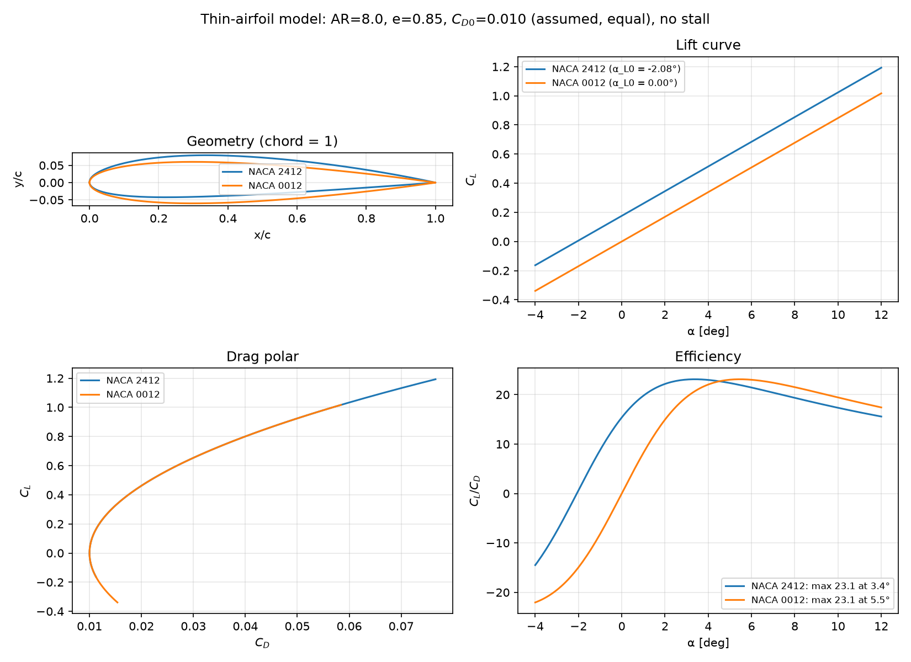

# NACA 2412 vs NACA 0012: Thin-Airfoil-Theory Analysis

All numbers below are **model estimates** produced by `main.py`. None are experimental measurements.

## 1. Problem

How does camber change the lift and drag-polar behavior of an airfoil? We compare a cambered airfoil (NACA 2412) with a symmetric one (NACA 0012) of equal thickness (12 %).

## 2. Geometry (`geometry.py`)

NACA 4-digit code MPTT: m = M/100 (max camber), p = P/10 (its chordwise position), t = TT/100 (max thickness), chord c = 1.

- Thickness (empirical NACA fit): y_t = 5t(0.2969√x − 0.1260x − 0.3516x² + 0.2843x³ − 0.1036x⁴)
- Camber line, two parabolic arcs joined at x = p:
  - x < p: y_c = (m/p²)(2px − x²)
  - x ≥ p: y_c = (m/(1−p)²)((1−2p) + 2px − x²)
- Surfaces are offset perpendicular to the camber line, with θ = arctan(dy_c/dx): x_u = x − y_t sinθ, y_u = y_c + y_t cosθ (lower surface with opposite signs).

Verification (`check_geometry`): NACA 2412 gives camber 0.0200 at x = 0.400 and thickness 0.1200 at x = 0.300, with a closed trailing edge. These match the definition of the code.

## 3. Lift (`aerodynamics.py`)

**Physical principle.** In thin airfoil theory the airfoil is replaced by a vortex sheet on the camber line. The flow-tangency condition fixes the vortex strength, and the Kutta condition fixes the circulation.

**Assumptions.** 2D, inviscid, incompressible, small angles, thin airfoil.

**Result.** With x = (1 − cosθ)/2, the tangency condition is a Fourier problem. Its first two coefficients give

- C_l = 2π(α − α_L0)
- α_L0 = −(1/π) ∫₀^π (dy_c/dx)(cosθ − 1) dθ

**Interpretation.** The lift slope 2π per radian does not depend on camber. Camber only shifts α_L0. For a symmetric airfoil dy_c/dx = 0, so α_L0 = 0.

**Finite wing (Prandtl lifting line).** a = a₀ / (1 + a₀/(π e AR)) with a₀ = 2π. For AR = 8 and e = 0.85 this gives a = 4.855 per radian. Here AR and e are assumed inputs.

**Numerical result.** NACA 2412: α_L0 = −2.077°, so C_L(α = 0°) = 0.176. NACA 0012: α_L0 = 0, so C_L(0°) = 0. Quoted values for the 2412 are about −2°; check this against a cited source before using it in a paper.

## 4. Drag

**Assumed model.** C_D = C_D0 + C_L²/(π e AR).

- The second term is induced drag. It exists only for a finite wing, not for a 2D airfoil.
- **C_D0 = 0.010 is an assumed placeholder for both airfoils.** It is not computed by this model and not measured.

## 5. Efficiency

Setting d(C_L/C_D)/dC_L = 0 gives C_L* = √(C_D0 π e AR) and (L/D)max = 1/(2√(C_D0 k)), with k = 1/(π e AR).

Numerical check: both airfoils give C_L* = 0.462 and (L/D)max = 23.11. The simulation and the closed form agree.

| | α_L0 | C_L(0°) | (L/D)max | α at (L/D)max |
|---|---|---|---|---|
| NACA 2412 | −2.08° | 0.176 | 23.11 | 3.4° |
| NACA 0012 | 0° | 0 | 23.11 | 5.5° |

## 6. Findings

1. **Supported by the model:** a cambered airfoil produces positive lift at α = 0°. Its lift curve is shifted by |α_L0| ≈ 2.1° relative to the symmetric one.
2. **Supported by the model:** the best-glide point occurs at the same C_L for both airfoils, but at a smaller angle of attack for the cambered one (3.4° versus 5.5°).
3. **Not supported by this model:** that the NACA 2412 has a *higher* peak L/D. In a parabolic polar with equal C_D0, (L/D)max is independent of camber. Any real difference would come from airfoil-specific C_D0, which depends on Reynolds number and surface condition.
4. **Not modeled:** stall. The linear lift curve has no maximum, so the drag rise and efficiency loss at high angle of attack seen in real wings do not appear here.

## 7. Limitations

- Linear regime only (α about −4° to 12°).
- Thickness does not affect C_L in thin airfoil theory.
- No viscosity, Reynolds number, Mach number or ground effect.
- C_D0, AR and e are assumptions.

## 8. Next steps (requires data not yet available)

- Obtain viscous polars for both airfoils (XFOIL or a wind-tunnel dataset, with cited Reynolds number) and replace the assumed C_D0 with airfoil-specific values.
- Compare the thin-airfoil C_L(α) against that data and quantify the deviation.
- Add a stall model or restrict conclusions to the pre-stall range.
